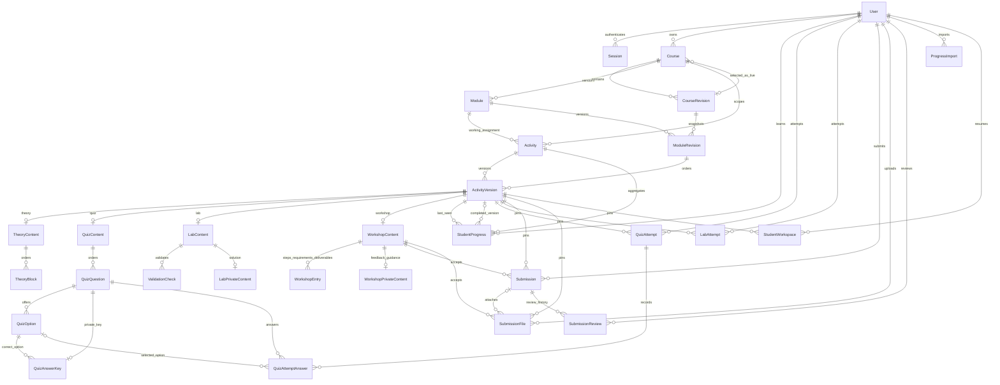

# Stage 5E database and API proposal

> **Historical proposal, superseded as an implementation reference.** Reviewed context below is 26 October 2026. The active schema now includes six learning tables and connected Instructor/Student flows; this candidate schema and its proposed endpoints remain unselected/unimplemented as written. Use the [current backend guide](../../../docs/BACKEND-GUIDE.md), [architecture](../../../docs/PROJECT-ARCHITECTURE.md), and [status](../../../docs/PROJECT-STATUS.md) before planning changes.

Review status: **schema proposal only**, 26 October 2026. Prepared on the existing
`feature/database-schema` branch, the schema branch in this checkout. The initial
review did not change runtime source or the database. No proposed content-schema
migrations have been applied.

Follow-up: the project owner clarified that application logic may change while
the UI stays intact. The single-instructor login, account provisioning, and route
guards are now implemented separately; see [current authentication setup](../../AUTH.md).
Findings and implementation plans below retain the original schema-review context.
The active content schema/migrations remain unchanged and await review.

The complete candidate Prisma schema is [schema.proposed.prisma](schema.proposed.prisma).
It is deliberately outside `backend/prisma/` and is not selected by
`backend/prisma.config.ts`. The SQL requirements below are part of the proposal;
Prisma validation alone does not enforce them or API authorization.

## Findings from this checkout

| Existing source | Observed behavior / integration consequence |
| --- | --- |
| `backend/prisma/schema.prisma` | Only `User` and `Session`; both already use PostgreSQL UUIDs. Preserve existing IDs, table/column mappings, password hashes, and session tokens. |
| `backend/prisma/migrations/20261022000000_init` and `20261024000000_auth_sessions` | Existing migrations create `users`, `sessions`, and `UserRole`. Add subsequent migrations; never rewrite these. |
| `backend/src/auth/auth.service.ts` | Email is trimmed/lowercased, public registration forces `STUDENT`, login verifies the stored password hash, and `/auth/me` reads the database session/user. Reuse this mechanism. |
| `backend/src/auth/password.ts` | Existing password format is salted scrypt (`N=32768,r=8,p=3`). Bootstrap must use `hashPassword`, not plaintext or a different seed hash format. |
| `frontend/app/components/auth/auth-form.tsx` | Students currently redirect to `/dashboard`; all other roles redirect to `/login/success`. Role-based instructor routing is not implemented. |
| `frontend/app/instructor/layout.tsx`, `frontend/app/lib/instructor/access.ts` | Instructor pages are unrestricted development previews and return 404 in production. A real session/ownership guard must replace this preview gate during implementation. |
| `frontend/app/lib/student/curriculum-repository.ts` | Course IDs `html`, `css`, `javascript`; nine stable module keys; namespaced activity IDs generated with `legacyActivityId`. No positional ID mapping is safe. |
| `frontend/app/lib/instructor/*-types.ts` | Drafts have format version 1 and an optimistic `revision`; incomplete content is intentionally saveable. Course/module/activity timestamps can be unknown for seeded content. |
| `frontend/app/lib/student/progress.ts`, `types.ts`, `activity-records.ts` | Progress uses both raw references and namespaced IDs, account-keyed local storage, limited quiz history, code drafts, lab summaries, workshop step keys, visits, and recent activity. |
| `frontend/app/lib/instructor/submission-types.ts` | `FutureSubmissionGateway` is a proposed contract with version-pinned upload/finalize/review/download DTOs; no implementation exists. |
| [Stage 5D documentation](../../../frontend/docs/instructor-dashboard-stage-5d.md) | `decode-instructor-preview-v1` roots 1–4 hold drafts. `decode-instructor-submissions-demo-v1` holds fictional metadata and must never become real submissions/reviews. |

Paths in the table are relative to the repository root. The local checkout was
the source of truth; the supplied GitHub URL could not be fetched through the
web reader during this review.

## Single-instructor login and authorization contract

There is exactly one designated instructor identity: `decode.instructor@gmail.com`.
Its initial password is the password supplied by the project owner in this task.
Pass that value through a deployment/bootstrap secret (for example
`INSTRUCTOR_BOOTSTRAP_PASSWORD`); do not commit it, put it in a migration, return
it in an API, or compare it directly in frontend code. This is the existing
email/password authentication flow, not Google OAuth.

1. Before public registration is enabled, provision the designated email through
   a controlled bootstrap transaction using the existing `User` table and password
   helper. Set role `INSTRUCTOR`. Reruns must leave the existing hash/UUID intact.
   If the address already belongs to an unexpected account, stop for an explicit
   identity reconciliation; do not silently promote or overwrite it.
2. Public registration always assigns `STUDENT`, ignores/rejects supplied roles,
   and reserves the designated email. There is no public promote-instructor API.
3. A successful login returns the existing `{ user: { id, name, email, role } }`
   DTO and HttpOnly session cookie. The designated authenticated `INSTRUCTOR`
   goes to `/instructor`; authenticated `STUDENT` users go to `/dashboard`.
   Wrong passwords do not create a session. Email normalization matches backend
   validation. The browser never grants access based on an entered email.
4. Every instructor page and API checks the verified backend session, the current
   database role, and the designated email. Every course operation additionally
   checks `Course.instructorId === session.user.id`. Students cannot bypass this
   by requesting an instructor URL/API or changing browser storage.
5. Student APIs require `STUDENT` and derive `studentId` from the session. Instructor
   accounts use the instructor dashboard. Retain `ADMIN` in the existing enum for
   compatibility, but it grants no special access in this single-instructor product.
   Before enforcing the strict role policy, audit and explicitly reconcile any
   existing `ADMIN` or other instructor records to `STUDENT`, preserving user IDs.
   Do not route an unrecognized/invalid role into an authenticated dashboard.
6. Authenticated page loads, refreshes, client navigation, and `/auth/me` use the
   same policy. Anonymous users go to `/login`; API requests return 401. Authenticated
   students attempting instructor APIs receive 403 (or scoped 404 for resources).
   Logout/expiry must also revoke instructor UI access. Revoke affected sessions
   during the role-policy cutover; never trust a cached role.

The later migration should enforce normalized email and the exact allowed role
combinations at the database level, in addition to service guards:

```sql
-- REVIEW EXAMPLE ONLY: run preflight/reconciliation before adding constraints.
ALTER TABLE users ADD CONSTRAINT users_normalized_email
  CHECK (email = lower(btrim(email)));
ALTER TABLE users ADD CONSTRAINT users_single_instructor_policy CHECK (
  (email = 'decode.instructor@gmail.com' AND role = 'INSTRUCTOR') OR
  (email <> 'decode.instructor@gmail.com' AND role = 'STUDENT')
);
CREATE UNIQUE INDEX users_one_instructor ON users (role)
  WHERE role = 'INSTRUCTOR';
CREATE UNIQUE INDEX course_revisions_one_draft
  ON course_revisions ("courseId") WHERE state = 'DRAFT';
```

The email/role CHECK plus the existing unique email already guarantees at most
one instructor; the partial unique index also records that policy explicitly.
Neither establishes that an instructor row exists: bootstrap and a readiness
check must establish that. Restrict deleting/demoting/renaming that identity in
the account service and database trigger, except via a separately reviewed
maintenance procedure. Do not grant the runtime database account schema-owner
or trigger-bypass privileges. Audit case-normalization collisions before adding
the email CHECK; never merge users and their progress just to resolve one.

## Identity and version design

Every new entity has a UUID primary key following the existing `@default(uuid())
@db.Uuid` convention. One-to-one content tables use their parent UUID as their
primary key. Prisma generates `uuid()` values: raw SQL imports must supply UUIDs.
New physical tables use snake_case mappings; their new columns use the Prisma
camelCase names. Existing `users`/`sessions` mappings remain unchanged.

`Course.key`, `Module.key`, and `Activity.key` are immutable public identifiers.
API curriculum `id` remains this key; it does **not** become the internal UUID.
Attempts, submissions, files, and published versions use UUIDs as opaque API IDs.
Structured entries/questions/options similarly expose their preserved `key`
through the existing frontend `id` fields. New entries get new keys; version
copies keep keys. Duplicated activities get fresh UUIDs, public keys, and entry
keys, and never inherit progress/reference bindings.

`CourseRevision` is a complete curriculum snapshot: course presentation fields,
`ModuleRevision` titles/order, and `ActivityVersion` titles/order/content/status.
An instructor edits one mutable DRAFT revision per course. Publishing freezes
that entire revision and atomically selects it through
`Course.publishedRevisionId`. The pointer's compound FK guarantees that it belongs
to that same course. All previously published revisions stay immutable and
addressable for authorized historical work.

This also versions module moves and ordering. `Activity.moduleId` describes the
working structural assignment; published navigation uses
`ActivityVersion.moduleRevisionId`, never the live module assignment. Identity
records cannot change course or activity type; moving within the same course
preserves the identity. A cross-course copy requires a new identity.

Course status is derived from the live pointer; working-draft state is separate.
Saving a draft does not clear a live pointer or unpublish anything. The frontend
adapter needs distinct `status` and `hasWorkingDraft` values instead of copying
the preview behavior that returns a course to Draft on structural edits.
Activity publication status belongs to each version. A live revision may retain
DRAFT activity entries for instructor context; student projections omit them.

## ER diagram

All solid relationships below are enforced by FKs in the candidate. Composite
FKs additionally keep course, activity, version, student, and attachment scope
consistent. Exact fields, uniqueness, indexes, and referential actions are in
the Prisma file; the diagram shows the main identity/version paths.



## Keys, constraints, indexes, and deletion

Every model has an explicit PK. The tables below list additional business keys.
An FK to a parent is indexed either explicitly or by a unique index with that
parent ID as its leading column. Redundant scope fields are intentional: they
enable compound FKs instead of trusting request-provided associations.

| Model(s) | Relationships and uniqueness beyond the primary key |
| --- | --- |
| `User`, `Session` | Existing unique email/token hash and session user/expiry indexes. No replacement auth tables. |
| `Course` | Unique public key; owner FK; live revision FK includes this course's ID; owner/archive index. |
| `CourseRevision` | Course FK; unique `(courseId, number)`; SQL-only unique draft per course; `(id, courseId)` supports scoped FKs. |
| `Module` | Course FK; unique public key and `(id, courseId)`; course/archive index. |
| `ModuleRevision` | FKs to module and revision both include course ID; unique module and unique position per course revision. |
| `Activity` | Course FK and module/course FK; unique public key; unique nullable `(referenceKind, referenceId)` seed binding; module and course/archive indexes. |
| `ActivityVersion` | Activity/course FK and module/revision/course FK; one activity per course revision; one position per module revision; `(id, activityId)` supports pinned records. |
| `TheoryContent`, `QuizContent`, `LabContent`, `WorkshopContent` | Shared PK/FK to activity version, at most one row of each kind. Type exclusivity needs the additional trigger below. |
| `TheoryBlock`, `ValidationCheck` | Version-content FK; unique key and position per content version. |
| `QuizQuestion` | Quiz-version FK; unique key and position per quiz version; `(id, activityVersionId)` supports version-safe answers. |
| `QuizOption` | Question FK; unique key and position per question; `(id, questionId)` supports matching options. |
| `QuizAnswerKey` | Shared question PK/FK; compound option/question FK makes a correct option from another question impossible. Drafts can omit a key. |
| `LabPrivateContent`, `WorkshopPrivateContent` | Shared PK/FK to matching content version; never selected in student DTOs. |
| `WorkshopEntry` | Workshop-version FK; unique key per workshop; unique `(activityVersionId, kind, position)`. |
| `StudentProgress` | User/student and activity FKs; one `(studentId, activityId)` record; compound last-seen and nullable completed-version FKs both bind to that activity; student/state/time index. |
| `QuizAttempt`, `LabAttempt` | Student FK; compound activity-version FK; unique attempt number per student/activity; unique student/idempotency key. QuizAttempt also has a unique nullable `(studentId, activityId, legacyKey)` for import deduplication. Ordered student/activity/time/ID indexes. |
| `QuizAttemptAnswer` | Compound attempt/version, question/version, and nullable option/question FKs; one question response per attempt. These prevent answers crossing questions or quiz versions. |
| `Submission` | Student FK; compound activity/version FK plus WorkshopContent FK; unique attempt per student/activity; unique student/idempotency key; student/time/ID and activity/status/time/ID pagination indexes. |
| `SubmissionFile` | Student FK, activity/version FK, workshop FK, and nullable submission/student/version FK; unique provider/bucket/key; unique student/idempotency key; state/expiry and scan/time indexes. An upload cannot attach to someone else's submission or a different workshop version. |
| `SubmissionReview` | Submission and reviewer FKs; unique `(submissionId, revision)`; submission/visibility/revision and reviewer/time indexes. Immutable event history. |
| `ProgressImport` | Student FK; unique `(studentId, snapshotHash)` and `(studentId, idempotencyKey)` for repeated-import safety. Original snapshot, payload hash and reconciliation report retained. |
| `StudentWorkspace` | Student FK; compound activity/version FK; unique `(studentId, activityVersionId)` for code, quiz, and workshop resume state. |

All **new** FKs use `onDelete: Restrict, onUpdate: Restrict`. The existing
`Session.user` cascade is preserved: deleting a user can delete sessions, but
new student/owner/reviewer references block the user deletion transaction.
There is no curriculum-to-progress, submission, file, or review cascade.

Use archive/unpublish operations, not general-purpose hard-delete endpoints.
Archive timestamps on Course/Module/Activity mark identity lifecycle; published
student navigation is controlled by publishing a replacement snapshot, or by
explicitly unpublishing the whole course. Archiving an identity alone must not
silently alter a frozen live snapshot. An archive-and-publish action can make
both changes in one transaction. Historical submissions remain accessible to
their student and authorized owner even after a course is unpublished.

Do not hard-delete an identity that ever had a published version. Enforce this
with a trigger as well as the service. Optional removal of a never-published,
unreferenced draft is an explicit child-first transaction, not a cascade.
Account erasure/retention requires a separate reviewed anonymization procedure;
it must not be implemented as cascading deletion of learning history.

## Additional PostgreSQL migration requirements

Prisma expresses PKs, FKs, unique constraints, and indexes in the candidate.
The eventual migration must also include the following named CHECK constraints,
partial index, and triggers. They are required parts of the design, not guarantees
provided by the standalone candidate file.

| Constraint / trigger group | Required behavior |
| --- | --- |
| Numeric bounds | Positions, revision counters, release numbers, and attempt numbers are positive. Course position is an ordering hint with key tie-breaker, not globally unique. `minutes >= 0`; quiz pass percent and scores in 0–100; earned points in 0..total; total points positive; answer earned points nonnegative. Draft question points may be null or signed within frontend limits; publication requires meaningful positive points. |
| Identity validity | Nonempty keys; UUID PKs cannot change. Activity's course, type, public key, reference binding and Module's course/key are immutable. `referenceKind`/`referenceId` are either both null or both present; allowed kinds lesson/quiz/exercise/project must match activity type. New copies do not reuse seed reference bindings. |
| Role references | Insert/update of Course checks instructor role/designated identity. Student-owned records check STUDENT role. Reviews check designated instructor and ownership through submission → version → course. User role changes cannot invalidate these links. Row FKs alone cannot check a referenced user's role. |
| Revision state | DRAFT implies null `publishedAt`; PUBLISHED implies nonnull `publishedAt`. A live pointer selects a PUBLISHED revision of its own course. A published revision can never return to DRAFT. Only one DRAFT per course, enforced by the partial index above. |
| Published immutability | Reject INSERT/UPDATE/DELETE against a PUBLISHED revision's module/activity/content/question/option/key/check/entry/private-note rows, and reject edits/deletion of the revision itself. Resolve the parent revision on both OLD and NEW paths, so reparenting cannot bypass the check. All descendant writes and publish operations lock the same Course row before testing state, preventing edit/publish races. |
| Content type | On every content insert/update, check Activity.type matches the subtype. Published activity entries require exactly one matching content row and no other subtype. Incomplete DRAFT entries can have no content. Publish validates all nested JSON shapes, IDs, allowed enums, limits, text/link safety, quiz keys/options, and readiness in the locked transaction. |
| Historical identity protection | Reject deletion of previously published Course/Module/Activity identities even if the live pointer is cleared. Published descendant rows are independently immutable. Preserve records referenced by attempts/progress/submissions even when not current. |
| Progress | COMPLETED requires `completedActivityVersionId`; other states have no completed-version/time fields. Server completions require `completedAt`; LEGACY_IMPORT can preserve unknown completion time as null. Last and completed versions must be eligible published versions, never instructor drafts. Later visits change only last-seen version and never erase the completed version/state. |
| Attempts | Quiz/lab records must point to PUBLISHED entries in PUBLISHED course revisions of the matching type. Runtime student ownership and grading enforced in NestJS; aggregate totals checked against stored answer rows. Quiz and lab attempts/answers are append-only. Legacy summary counts are not fabricated as attempt rows. |
| Upload policy | Nullable workshop policy means uploads disabled. Configured policies require nonblank instructions, allowlisted extensions, 1–50 MiB per file, 1–5 files, and estimated time 1–10,080 minutes where supplied. Seeded published workshops may stay readable with null policy. Drafts can save incomplete settings. |
| File lifecycle | Expected/actual sizes are positive and within platform limits; expiry after issue; checksums are 64 lowercase hex characters when set. ATTACHED iff submissionId is nonnull; attachment requires uploadedAt, verified size/type/checksum, CLEAN scan, immutable storage version/reference. A file's owner/version binding cannot change, and once attached its submission/storage binding cannot change. scanStatus may later become REJECTED on rescan while state stays ATTACHED; downloads then stop. |
| Submission finalization | Workshop entry must be published and eligible; owned verified CLEAN uploads must be unexpired, unattached, same version, and within byte/count policy. Lock files and a student/activity counter row (the unique StudentProgress row) before allocating attempt number; insert submission, attach all files, and record idempotency atomically. Never use unlocked MAX(attempt)+1. |
| Review state and visibility | Append-only review events. PUBLISHED visibility requires final REVIEWED/CHANGES_REQUESTED status, nonblank feedback, reviewedAt and publishedAt. PRIVATE events have null publishedAt; final statuses require feedback and reviewedAt even when private, other statuses have null reviewedAt. Submission revision/status and appended event revision/status advance atomically, rejecting stale expectedRevision. No row rewrites to erase previous feedback. |

CHECKs validate the current row. Cross-table invariants belong in compound FKs
where possible and in carefully locked triggers/transactions otherwise; do not
write CHECK expressions that query mutable tables. Immutability, role checks,
and state transitions must not rely only on frontend validation. See the
[PostgreSQL constraint guidance](https://www.postgresql.org/docs/current/ddl-constraints.html),
[Prisma referential actions](https://www.prisma.io/docs/orm/v7/prisma-schema/data-model/relations/referential-actions),
and [custom database features in migrations](https://www.prisma.io/docs/orm/v7/prisma-schema/data-model/unsupported-database-features).
This proposal keeps the partial draft index in custom SQL; evaluate installed
Prisma support before choosing a schema-level representation.

## Publishing transaction

1. Lock the Course row and verify instructor ownership. Require the expected
   draft revision (409 on stale writes). A draft save updates the revision only
   for meaningful changes; no-op saves retain timestamps/revision.
2. Validate the entire snapshot, including content type and publication readiness
   for entries selected PUBLISHED. Hidden DRAFT entries remain unavailable to
   students. Freeze and timestamp the revision, then switch the live pointer.
3. Commit atomically. Opening a subsequent draft copies the current published
   tree into new version UUIDs, preserves identity/entry keys, and sets the new
   revision to DRAFT. Lazy draft creation avoids creating copies on every read.
   Older version UUIDs are never repointed or rewritten.
4. Reordering uses temporary unused positive positions in the same transaction
   before assigning final positions, avoiding intermediate unique collisions.
   Rollback returns the old order. Editing/moving/archiving drafts cannot alter
   student queries, which always use a selected immutable snapshot.

An older published version can be loaded only through an authorized historical
progress/attempt/submission/workspace relationship, or an eligible version lease
already established by that student's workspace. Fresh student navigation uses
the current published pointer. Quiz/lab/finalize requests accept a version pinned
before a newer publish if that workspace/upload lease is still eligible. New
upload intents require a currently published workshop; already-issued tickets
can finalize their historical published version until expiry, unless explicitly
revoked. Course unpublish revokes new work and outstanding leases; reading one's
existing submitted work/feedback remains allowed. Apply this policy explicitly
instead of accepting any arbitrary old version UUID supplied by a client.

## Stable ID and local-data migration

The canonical seed mapping is generated from
`frontend/app/lib/student/curriculum-repository.ts`, preserving membership and
order: **3 courses, 9 modules, 38 activities** (25 theory, 3 quiz, 6 lab, 4 workshop).
The importer must calculate and assert actual counts/types from source before
deployment; any mismatch stops cutover. Do not invent IDs from titles or order.

| Existing value / shape | Database mapping |
| --- | --- |
| `html`, `css`, `javascript` | `Course.key`; allocate UUID once and reuse through unique-key upserts. |
| `html-first-page`, `html-meaning`, etc. | `Module.key`; preserve course membership. |
| `exercise:html-heading` | `Activity.key`; referenceKind `exercise`, referenceId `html-heading`, type LAB. |
| `project:portfolio` | `Activity.key`; referenceKind `project`, referenceId `portfolio`, type WORKSHOP. |
| `lesson:html-introduction`, `quiz:html` | Activity keys with respective theory/quiz seed bindings. |
| `lessons[]`, `challenges[]`, `projects[]` | Resolve raw IDs via `lesson:`, `exercise:`, `project:`; merge StudentProgress by student/activity, preserving completed state. |
| `quizzes.html`, `quizHistory.html`, `quizSessions.html` | Resolve `quiz:html`; preserve latest/best/count summary even if only the last 20 attempts remain. Re-score available answers against the baseline version; mark imported records LEGACY_IMPORT. Never fabricate missing attempts. |
| Quiz answer numeric indices | Map against the original option order; preserve existing question keys and generated `${questionId}-option-${index+1}` keys from `initialQuizContent`. Never use a newer draft's option order. |
| `labChecks[rawId]` | Resolve `exercise:rawId`, preserve requirement keys/results and aggregate attempt count. Keep historical self-reported completion separate from verified server grading. |
| `workshops[projectId]` | Resolve `project:projectId`; preserve original completed/current step keys in StudentWorkspace, pinned to the baseline version. |
| `visits[].activityId` | Resolve namespaced key; retain last visit time per activity. |
| `drafts['project-*']`, `challenge-*`, `lesson-*` | Map to workshop/lab/theory baseline workspaces; preserve code verbatim. Playground template drafts are not course activities and remain local or in the retained import snapshot until a dedicated preference store is implemented. |
| `currentLesson`, recent `activity[]` | Preserve in ProgressImport; the compatibility adapter must restore them until a dedicated student-navigation/preferences contract is added. Do not delete browser state before this is supported. |

Migration stages, after schema/API review:

1. **Preflight and backups.** Capture migration status, PostgreSQL version,
   user/role/email collision reports and database backup. Do not print .env or
   hashes. Browser-local data is absent from PostgreSQL: expose an explicit
   validated export/import flow. The shared instructor preview needs the owner's
   explicit choice of snapshot, not an automatic import from every browser.
2. **Additive migration `stage_5e_content_versions`.** Create curriculum/version/
   content tables, indexes, scope FKs, draft uniqueness and immutability/type
   triggers. Do not drop/recreate users, sessions, existing IDs or enums.
3. **Additive migration `stage_5e_learning_submissions`.** Create progress,
   workspace, attempts, imports, upload metadata, submissions and reviews plus
   bounds/append-only/ownership triggers. No project file bytes or signed URLs
   are stored in these tables.
4. **Controlled account bootstrap and role policy migration.** Audit/reconcile
   existing identities, provision the designated account with the supplied secret
   through the existing hash helper, revoke affected sessions, add normalized
   email/single-instructor constraints, then verify exactly one instructor.
   Provisioning and constraint installation require a maintenance window or an
   equivalent registration lock so the reserved email cannot be raced.
5. **Idempotent seed backfill.** Import the exact current student curriculum as
   baseline published snapshots under the designated owner; preserve public keys,
   question/option/step keys and starter code. The importer supplies UUIDs for SQL
   inserts. Database createdAt/publishedAt reflect import/cutover time, not invented
   historical authorship dates. Keep legacy unknown source dates unknown in DTOs.
   Unconfigured original workshop upload policies remain null/disabled.
6. **Import instructor drafts separately.** Parse roots 1–4, validate each editor
   document, and write DRAFT snapshots only. Preserve local activity/module/course
   keys; copies stay unpublished. Unsupported roots or colliding keys stop that
   import and preserve the raw export for reconciliation. No fictional submissions
   or review records are imported from demo storage, including recovery keys.
7. **Authenticated student import.** Read only the active account's
   `decode-learning-v1-${studentId}` after session verification and explicit opt-in.
   Bind the imported owner to session.user.id, never a student ID in the payload.
   Mock/demo/shared-profile snapshots need explicit owner reconciliation. Save the
   original snapshot + hash + per-record report in ProgressImport before mapping;
   unknown references remain in the report/backup, never silently discarded.
   Deduplicate by student/hash and source attempt key, merge completion monotonically,
   preserve best scores and unknown timestamps. Import summary/attempt/workspace
   writes in one transaction; reject unsupported versions without clearing storage.
8. **API/adapter cutover.** Deploy the guards and persistence adapters together;
   verify parity before making PostgreSQL authoritative. Keep a browser export and
   database backup through the cutover. A failed import rolls back and is retryable.
   Application rollback preserves the new tables/data; do not use destructive down
   migrations or `prisma migrate reset`. A failed publish rolls back its pointer.

Imported browser results are labeled LEGACY_IMPORT and never treated as evidence
of verified grading/upload delivery. Existing completions remain visible. Server
quiz grading/lab validation can establish new verified records without clearing
those completions. New publications retain completion by activity identity and
retain the version on which it was earned; no automatic progress reset.

## Proposed HTTP contracts

Backend prefix is `/api` (Nest global prefix). Frontend `/api/...` proxies retain
the existing HttpOnly session mechanism. The contract uses lower-case frontend
activity types and `pending`, `in-review`, `changes-requested`, `reviewed` statuses;
the adapter maps them explicitly to Prisma enums. Date/time fields are UTC ISO
8601; file sizes are integer bytes. Convert the editor's `maxFileSizeMb` to MiB
(`value * 1024 * 1024`) explicitly. JSON code/entry payloads carry format version
1 at the DTO boundary; format version and optimistic revision are distinct.

| Method and path | Contract |
| --- | --- |
| Existing `POST /auth/register`, `POST /auth/login`, `GET /auth/me`, `POST /auth/logout` | Preserve response/cookie shape; enforce reserved instructor identity and redirects described above. |
| `GET /instructor/courses` | Owner-scoped course metadata with public keys, live status, `hasWorkingDraft`, draft revision and known source dates. Cursor pagination. |
| `POST /instructor/courses` | Create UUID/public key, ownership from session, initial DRAFT snapshot; caller cannot assign owner. |
| `GET /instructor/courses/:courseKey/draft` | Return typed full Course → Module → Activity tree plus draft revision and saved editor content. If no draft, return published source + null draft revision; no write on GET. |
| `PUT /instructor/courses/:courseKey/draft` | `{ expectedRevision: number | null, content: DraftCourseTree }`; transactionally create/update the full snapshot and editor content. Null expectation means no draft exists yet. Missing existing identities cannot imply destructive deletion. Reorders/moves preserve keys; omission is a draft-only removal and never deletes identity/history. |
| `POST /instructor/courses/:courseKey/publish` | `{ expectedRevision }`; readiness validation, atomic snapshot publication; returns live revision UUID/number. |
| `POST /instructor/courses/:courseKey/unpublish` | `{ expectedPublishedRevisionId }`; explicit live-pointer removal, 409 if stale, revoke new-work leases; historical submitted records retained. |
| `POST /instructor/courses/:courseKey/archive` | `{ archived, expectedRevision }`; update identity lifecycle; publish a replacement snapshot separately/atomically when live visibility must change. Module/activity archive follows the same policy through the draft command. |
| `POST /instructor/courses/:courseKey/duplicate` | Expected source revision; copies content with new identities/entry keys into a new unpublished course, no progress/submission binding. Activity duplication follows the same rule. This create command is not automatically retryable. |
| `GET /curriculum` | Only current published revisions and PUBLISHED activity entries, existing `CurriculumPath` IDs/routes plus `activityVersionId`; student-specific progress is separate. Seed path key `web-development` remains the single adapter path. |
| `GET /activities/:activityKey?versionId=...` | Safe student content projection; default live version. Historical version requires the student's own eligible pinned work. No answer keys, solution, private rubric guidance or storage references. |
| `GET /me/progress` | Only session student's completion/last-seen state and compatible aggregates. |
| `PUT /me/progress/:activityKey` | `{ activityVersionId, expectedRevision, action }`; visit or theory/workshop self-completion only with validated steps; quiz/lab completion comes from server attempt evaluation. No student-supplied scores or completion flags for graded work. |
| `PUT /me/workspaces/:activityKey` | `{ activityVersionId, expectedRevision, code?, quizSession?, workshopState? }`; owned, version-pinned save with runtime schema/size validation. GET counterpart restores it. |
| `POST /me/progress/import` | `{ idempotencyKey, sourceVersion, snapshot }`; explicit legacy import, session-bound owner, report of mapped/unmapped/conflicting records; no demo-review import. |
| `POST /activities/:activityKey/quiz-attempts` | `{ activityVersionId, answers: [{ questionId, optionId }], idempotencyKey }`; entry IDs are preserved public keys resolved within that version; server scores atomically and updates aggregate progress. |
| `POST /activities/:activityKey/lab-attempts` | `{ activityVersionId, code, idempotencyKey }`; isolated server validation computes results/completion. Client check booleans are untrusted; never execute authored/student code in the Nest process. |
| `POST /submissions/upload-intents` | Existing `SubmissionUploadIntent` → `SubmissionUploadTicket`; session-bound student/version/filename/size/type/idempotency key, private expiring upload capability. |
| `GET /submissions/uploads/:fileId` | Additional proposal: owner-only `{ fileId, state, scanStatus, expiresAt }`; lets finalization wait for server verification/scanning. Never returns object keys. |
| `POST /submissions` | Existing finalize DTO `{ activityId, workshopVersionId, fileIds, idempotencyKey }` → `ProjectSubmissionMetadata`; activityId is the stable public key, version/file IDs are UUIDs. |
| `GET /me/submissions?cursor=...` | `FutureSubmissionGateway.listOwn`; only current student's submissions. |
| `GET /instructor/submissions?courseId=&activityId=&status=&search=&cursor=...` | Owner-scoped `listForInstructor`; course/activity filters use public keys and cannot widen authorization. |
| `GET /submissions/:id` | Owner student or authorized course instructor only; returns metadata projection. |
| `POST /submissions/:id/review` | Existing `{ feedback, status, expectedRevision }`; instructor only, append event and advance submission revision. Final REVIEWED/CHANGES_REQUESTED publishes feedback, nonfinal states keep it private. |
| `POST /submissions/:id/files/:fileId/download` | Existing download ticket DTO; authenticate student owner or authorized course owner, verify file belongs to submission and scan CLEAN, return expiring capability/attachment stream. |

The full-tree draft write deliberately serializes all editors with one course
draft revision. The adapter must refetch/rebase on conflicts; concurrent editor
saves must not silently replace sibling content. If per-editor concurrency is
needed later, add explicit activity-level revision columns and patch endpoints
before implementation, rather than assuming the preview's separate counters
are interchangeable with a course revision. Stage 5E does not require separate
module/activity persistence catalogs on the frontend.

Example compatibility projection (illustrative placeholders, not literal UUIDs):

```json
{
  "id": "project:portfolio",
  "type": "workshop",
  "reference": { "kind": "project", "id": "portfolio" },
  "href": "/projects/portfolio",
  "activityVersionId": "<published-activity-version-uuid>"
}
```

For new activities without legacy references, agree a new activity-key route
such as `/activities/:activityKey`; existing `/lessons`, `/quizzes`, `/challenges`
and `/projects` routes remain resolvable through the seed binding. This requires
a later frontend adapter/route change, not renaming existing references.

`ProjectSubmissionMetadata.courseId/moduleId/activityId` are public keys derived
from the **pinned** snapshot, not supplied by the browser or joined from the
mutable working module. `workshopVersionId` is the ActivityVersion UUID, also the
WorkshopContent PK. File metadata exposes only the existing ID/name/verified
size/type/scan DTO. Instructor projection returns the latest review event;
student projection returns only the latest PUBLISHED review, or empty feedback
with null review/reviewer timestamps if none exists. Private review drafts and
`WorkshopPrivateContent.feedbackGuidance` are never included.

Review transitions: PENDING → IN_REVIEW or a final status; IN_REVIEW → PENDING or
a final status; final → IN_REVIEW to reopen, then another final status. Identical
saves are no-ops. Reopening preserves previously published feedback/history;
it does not turn that feedback into an unpublished draft. A resubmission creates
a new attempt with PENDING status and no inherited review. Workshop guide-step
completion and submission/review status remain separate concepts.

For endpoints accepting an idempotency key, idempotency is scoped by authenticated
user and endpoint. Import uses its receipt row plus snapshot hash; quiz imports
also deduplicate by the preserved legacy attempt key. Store a canonical
payload hash alongside the key; same key/same payload replays the result, while
same key/different payload returns 409. Lock the student/activity progress row
before quiz/lab/submission attempt-number allocation; start after the greater of
the existing attempt maximum and any retained legacy aggregate count, without
inventing missing historical rows. The unique attempt key is the final race
barrier. Review retries use expectedRevision; a stale retry gets
409 and the caller reloads. Lists use an opaque scope-bound `(submittedAt,id)`
cursor (or equivalent timestamp for course lists), maximum 100 items. Default 25.

Errors: 400 malformed input, 401 missing/expired session, 403 wrong role, 404 for
missing/out-of-scope resources, 409 revision/idempotency/upload-not-ready conflict,
413 size limits, 422 publication/content validation, 503 unavailable dependency.
Use `{ statusCode, code, message, fieldErrors? }`; avoid error text that reveals
another student's existence. Cookie-authenticated writes reuse origin/CSRF
checks from auth; response metadata and signed capabilities use `Cache-Control:
no-store`. Do not pass Prisma records straight to the browser.

## Private storage and feedback lifecycle

The provider is not yet selected. Use a private bucket/container with generated
unguessable keys, quarantine, server-verified content type/size/extension and
archive decompression limits, malware scanning, encryption and access audit.
PostgreSQL stores references/metadata only, never ZIP bytes or durable signed
URLs. Starter/source code text stored in content/workspaces is not an uploaded
project archive. Prevent overwriting already verified bytes: bind verification,
finalization, and download to the exact object version/checksum, or an immutable
copy in private storage. Upload URLs expire and cannot read/list the bucket.

Expired unattached uploads are cleaned asynchronously; cleanup selects only
unattached expired objects and cannot remove attached submission files. Separate
retention rules govern real submissions. Authorized downloads recheck current
ownership, attachment, and clean scan state, sanitize the display filename, and
use safe attachment headers/isolated delivery for active content. Never render
uploaded HTML/JS in the instructor/application origin. Issued download tickets
have a short lifetime (proposal: at most five minutes); authorization is checked
when issuing each ticket, and streaming can be used where immediate revocation
is required. Never persist these capabilities in local storage.

## Review and validation before implementation

The following contracts need joint frontend/backend sign-off: course-wide draft
concurrency, identity-key projection and routes for newly authored activities,
publication/historical-version leases, upload scan polling/file-count policy,
review publication semantics, single-instructor provisioning and legacy imports.
Storage provider and retention duration remain deployment decisions; they do
not change the FK/identity/version design.

Candidate check, run from `backend/` without migrating a database:

```powershell
.\node_modules\.bin\prisma.cmd validate --schema docs/stage-5e/schema.proposed.prisma
```

Verification performed for this proposal:

- Candidate formatted and validated with the installed Prisma CLI: passed.
- Offline `prisma migrate diff --from-schema prisma/schema.prisma --to-schema
  docs/stage-5e/schema.proposed.prisma --script`: 27 new tables, 75 new indexes,
  46 new FKs; no destructive statements or changes to existing users/sessions.
  The preview was inspected in memory, not written as an executable migration.
  These counts exclude the custom SQL constraints/triggers proposed above.
- Seed inventory checked against source: 25 theory + 3 quiz + 6 lab + 4 workshop
  = 38 activities. Repository whitespace check passed.
- No live database or authentication behavior was tested or changed. Active
  schema and all tracked application/migration files remain unchanged.

Before applying any eventual migration, test it on an isolated PostgreSQL copy:
existing users/sessions and IDs survive; duplicate positions/foreign options/
cross-version answers/foreign upload attachments fail; concurrent draft saves,
publish/edit races and double finalize do not lose data; drafts never leak;
previous completions survive republish/module moves; deletes cannot destroy
published versions/progress/submissions; only the designated account reaches the
instructor page/API; other students cannot read another student's records or
private notes; upload expiry, scanning and download ownership are enforced;
repeated imports preserve counts/keys without duplicating attempts. Include
actual PostgreSQL integration checks for custom SQL rules, not only Prisma mocks.
