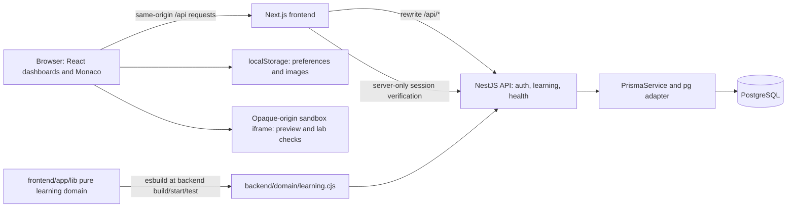
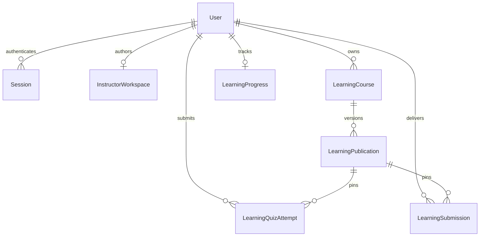

# Project architecture

Reviewed **2026-10-27**, source commit `59614ec`. [Agent entry](../AGENTS.md) · [Frontend](FRONTEND-GUIDE.md) · [Backend/API reference](BACKEND-GUIDE.md) · [Current status](PROJECT-STATUS.md)

## System overview



This is two separately installed npm packages. The root package contains no application scripts. Next renders public pages and protected workspaces; Nest is the authoritative data API. The frontend has an API rewrite, not a separate Next API implementation. PostgreSQL is the only implemented backend datastore.

## Frontend structure and state

`frontend/app/layout.tsx` owns global styles, Geist fonts and the prepaint theme script. Public routes are `/`, `/login`, `/register`, and legacy `/login/success`. `app/(student)/layout.tsx` and `app/instructor/layout.tsx` verify real sessions behind Suspense, then install their shells/providers. The `(student)` group does not appear in URLs.

| Boundary | Source | Behavior |
| --- | --- | --- |
| Verified student identity | `frontend/app/components/student/student-provider.tsx` | Client revalidation; hides/inerts cached content while checking; keys profile state by verified UUID |
| Connected learning state | `frontend/app/components/student/progress-provider.tsx` | Loads catalog/progress, serializes writes, retries failed work, submits quizzes |
| Student catalog projection | `frontend/app/lib/learning/catalog.ts` | Installs published courses into existing student collections; maps authoring IDs to references and route URLs |
| Connected authoring state | `frontend/app/components/instructor/instructor-provider.tsx`, `frontend/app/lib/instructor/remote-repository.ts` | External-store subscription, acknowledged commands, revision handling and legacy draft import |
| Pure domain | `frontend/app/lib/instructor/`, `frontend/app/lib/student/`, `frontend/app/lib/learning/domain.ts` | Typed content, readiness, command application, completion helpers, publication and private-field stripping |

Runtime catalog installation mutates module-level collections inside the client bundle. Preserve the provider's readiness gate and detail-page snapshot behavior; moving these collections into server-rendered account state would need explicit isolation design.

## Backend structure

`backend/src/main.ts` creates Nest with an Express JSON parser (2 MiB limit), configured credentialed CORS, graceful shutdown hooks, and global `/api` prefix. `AppModule` imports global `PrismaModule` and `AuthModule`; it registers `LearningController`/`LearningService` directly. There is no separate `LearningModule`, generic roles guard, DTO directory, Swagger contract, or global validation pipe in this checkout.

`AuthService` owns input validation, password checks and database sessions. `LearningController.user()` authenticates the role cookie and checks the required public role on every endpoint. `LearningService` performs ownership filtering, revision checks, transactions, publication, grading, and review. Health endpoints are independent of workspace authorization. See the [complete implemented endpoint inventory](BACKEND-GUIDE.md#implemented-api-endpoints).

## Database design

Prisma 7 takes the datasource URL from `backend/prisma.config.ts`; `schema.prisma` declares PostgreSQL and generates a CommonJS TypeScript client under ignored `backend/src/generated/prisma/`. `PrismaService` supplies `@prisma/adapter-pg`, uses UTC connections and five-second connection/query timeouts, and disconnects on shutdown. Connections are lazy.

Relational rows anchor identities, ownership, revisions, live-version pointers, quiz attempts and project deliveries. JSONB retains existing typed editor/progress documents. This intentionally differs from the unselected normalized Stage 5E proposal.



`LearningCourse.liveVersionId` optionally points at a publication of that same course. Migration SQL adds a composite foreign key enforcing this, revision/status checks, and triggers forbidding update/delete of publications and quiz attempts. Most learning ownership/history foreign keys use `RESTRICT`; only sessions cascade when their user is deleted. Inspect SQL alongside Prisma: not every invariant is expressible in the schema.

## Authentication and sessions

```mermaid
sequenceDiagram
  participant B as Browser
  participant N as Next.js
  participant A as AuthController/AuthService
  participant D as PostgreSQL
  B->>N: JSON register/login
  N->>A: /api/auth/register or /login
  A->>A: Validate JSON/origin and fields; verify/hash password
  A->>D: Create user if registering; store hashed session token
  A-->>B: Public user + HttpOnly role cookie and compatibility alias
  B->>N: Open role dashboard
  N->>A: Server-only /auth/me?scope=student or instructor
  A->>D: Verify token hash, expiry, current account
  A-->>N: Public identity only
  N-->>B: Protected layout, then client revalidation
```

Registration always creates a Student; the reserved instructor cannot register publicly. The designated identity must also have stored `INSTRUCTOR` role. Other stored roles, including `ADMIN`, currently map to public `STUDENT` access. This is a deliberate single-instructor deployment restriction, not general enum-based RBAC.

Passwords use salted scrypt; opaque random 256-bit session tokens are SHA-256 hashed in the database. Normal sign-in lasts 12 hours server-side with a browser-session cookie. Remember me uses a persistent cookie and 30-day expiry. Cookies are HttpOnly, SameSite=Lax, path `/`, Secure in production. Tokens are never returned in JSON or exposed to client props.

Separate `decode_student_session` / `decode_instructor_session` cookies allow concurrent workspaces in one browser; `decode_session` remains an alias for older clients. Scoped verification/logout selects its own cookie, falling back to the alias only when that scoped cookie is absent. An invalid present scoped cookie cannot fall back. Scoped logout revokes its token and clears matching aliases without clearing the other role's independent session.

Auth and learning writes require JSON, reject cross-site fetch metadata and disallowed supplied Origin values, and reuse the same exact-origin allowlist as CORS. Missing Origin alone is accepted for nonbrowser clients with valid cookies; this is not a token-based CSRF protocol. Protected responses use `no-store`. Server/client guards and API role/ownership checks are all required.

## Curriculum authoring and publication

1. `RemoteInstructorRepository` loads `{state, revision}` from `GET /api/learning/instructor`.
2. On first access, the service transactionally creates the instructor workspace, stable baseline courses and immutable baseline publications. Catalog loading also invokes initialization if the designated instructor already exists. No instructor account means no automatic baseline delivery.
3. A valid older `decode-instructor-preview-v1` backup with recorded changes can import into revision zero. The original backup remains; conflicts/recovery errors never silently overwrite it. Imported/new edited content remains draft work.
4. Course/module/activity actions and typed editor saves go to `POST /api/learning/instructor/commands` with an outer workspace `expectedRevision`. Content-save commands also carry activity draft revision/timestamp expectations.
5. The service runs shared `applyInstructorCommand` rules and compare-and-swap persistence in a transaction. Failed/stale saves do not replace acknowledged state. The UI reloads on 409 and reports the conflict.
6. Explicit `course.status` with `status: published` runs readiness and creates a new immutable `LearningPublication`, then advances the live pointer atomically. Seed content retains special baseline/readiness compatibility rules. Active module/activity array order is canonical; IDs are not positions.
7. Editor saves mark working course state draft without automatically removing the old live pointer. Explicit unpublish clears that pointer; course archiving suppresses catalog delivery. Module/activity edits reach students when a replacement snapshot is published.
8. Student curriculum exposes live, nonarchived courses to all registered students; there is no enrollment or assignment API. `studentCourse()` removes quiz keys/explanations, private lab solution, and private workshop review guidance.

The catalog provider refreshes on navigation/focus and every 30 seconds when visible and not saving. Existing course/activity detail pages retain loaded content; stale publication-aware writes/quiz submissions can return 409 and require reloading. Republish preserves reference-based completion records, rather than resetting student history.

## Student progress persistence

`Progress` in `frontend/app/lib/student/types.ts` contains lesson/challenge/project completion IDs, quiz aggregates/history, current lesson, visits/recent activity, code drafts, quiz sessions, lab checks, and workshop steps. `LearningProgress` stores one revisioned document per authenticated student.

The provider applies optimistic local transformations and drains them sequentially with `PUT /api/learning/progress`, `expectedRevision` and publication IDs. The server merges accepted nonquiz fields, validates current content references and code sizes, preserves server-owned scores/history, and advances the revision transactionally. Completions are additive. Failed writes block further updates, retain changes in the open page, and offer retry/rebase; the queue is not a durable offline store.

Theory completion and workshop steps are self-reviewed. A quiz contributes completion when the best score is at least 70%; each curriculum activity has equal completion weight. Lab completion requires an accepted passing check record and an explicit completion action. These measures describe learning progress, not credentials or proctored assessment.

`POST /progress/reset` replaces the current progress document but retains immutable quiz audit rows and delivered submissions. **The Profile button does not call this endpoint today**: it calls the ordinary merging update path. See [known limitations](PROJECT-STATUS.md#known-bugs-and-limitations).

## Quiz submission

1. Student catalog supplies questions/options without correct answers or explanations. Partial answers/index can persist in progress.
2. `QuizView` calls the provider with selected zero-based option indices and a stable retry `requestKey`; the provider waits for outstanding saves.
3. `POST /api/learning/quiz-attempts` identifies the student from the session, validates the current live publication/activity and every answer, and serializes attempts with a student advisory lock.
4. Server calculates the weighted percentage from question points. A transaction stores an immutable attempt and updates latest/best/count aggregates, up to 20 recent reviews per quiz, recent activity and revision. The returned review contains original questions, answers and explanations.
5. Same student/request key with identical payload replays safely; changed payload conflicts. An obsolete or archived publication conflicts. Generic progress writes cannot forge quiz results. Historical review snapshots remain usable after unpublish; resetting the working progress clears displayed aggregates/history but not immutable audit rows.

## Coding workspace, labs and assets

`CodeWorkspace` shares HTML/CSS/JavaScript tabs, explicit draft saving, preview/console, accessible textarea fallback, reset confirmation, viewport controls and unsaved-state handling. Monaco runtime, model lifetime and local language workers are separate from persistent code drafts.

Previews execute in `sandbox="allow-scripts"` iframes without same-origin access. Generated documents install restrictive CSP, sanitize embedded markup, disable network connections/forms/frames/workers, and validate messages by frame source, channel/schema and run token. Some preview modes allow public HTTPS images. This reduces access to the application; it is not a resource-limited remote execution service.

Lab checks use published structured element/text/attribute/style/click/runtime rules (and legacy lab checks), run at configured widths, and return per-requirement evidence. The API validates record shape/check identities and marks evidence `browser-check`. It does not independently execute code or establish that a client was honest. Keep browser tests and manual real-layout checks alongside unit tests.

Draft code persists in PostgreSQL. Optional image uploads remain account/workspace-keyed **localStorage** assets using `decode-image:` references: up to four images per workspace, supported raster formats, 256 KiB per image and additional serialized quotas. Neither cloud media storage nor portable image embedding in workshop deliveries is implemented.

## Workshop submission and review

```mermaid
sequenceDiagram
  participant S as Student workspace
  participant L as LearningService
  participant D as PostgreSQL
  participant I as Instructor Submissions UI
  S->>L: Save code/steps, then complete workshop via progress update
  L->>D: Transaction: validate all steps, store progress + source snapshot
  I->>L: GET instructor/submissions and /:id/code
  L-->>I: Owned submission metadata and source
  I->>L: POST instructor/reviews with expectedRevision
  L->>D: Save status/private feedback; publish feedback for final review states
  S->>L: GET submissions
  L-->>S: Own status and published feedback only
  S->>L: Save changed source; POST submissions/resubmit
  L->>D: Replace delivered code on same record; increment revision, set pending
```

Completing a workshop requires reviewed steps; it snapshots saved source (or the starter when no saved draft exists) into `LearningSubmission`, pinned to a publication. Review states are `pending`, `in-review`, `reviewed`, `changes-requested`. Only the last two publish new feedback, with a minimum feedback length. Reopening a draft does not erase previously published feedback. `reviewed` means feedback published, not a separate approval grade.

Changes requested permits resubmitting saved code on the same submission row. Previous published feedback remains; there is no separate immutable review-event or resubmission-history table. Instructor downloads are JSON source, not signed file-storage links. List endpoints cap at 500 and filter in the UI; no server paging is implemented.

## External services and deployment boundaries

- PostgreSQL is required; no Redis, object storage, execution service, OAuth provider, email delivery, payment provider, or analytics service integration is present in inspected runtime source.
- `next/font/google` fetches Geist/Geist Mono during frontend build. Monaco workers are bundled locally; they do not require a runtime editor CDN.
- User-supplied resource links/public HTTPS images can access external sites where allowed, without implying an application service integration.
- Production hosting, backups, storage provider, reliable platform event history and admin provisioning remain deployment/product decisions. Starter README links and Nest deploy tooling do not establish a deployed service.
- Admin frontend is branch-only and unintegrated; see [roles](ROLES-AND-FEATURES.md#admin) and [status evidence](PROJECT-STATUS.md#deferred-admin-dashboard). Do not add its proposed routes/tables to the implemented inventory.
